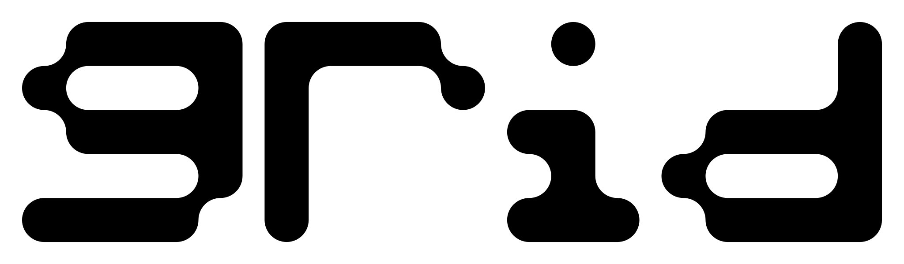
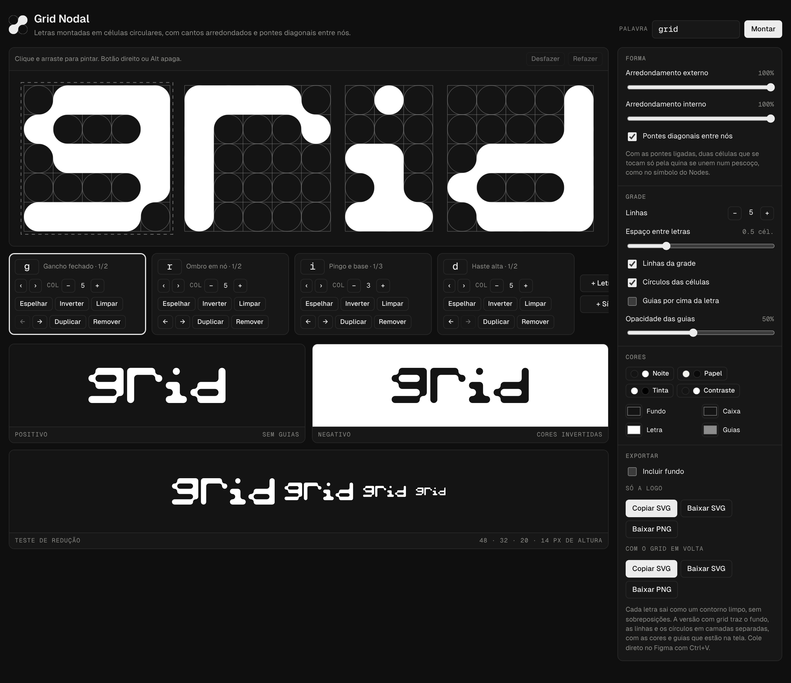
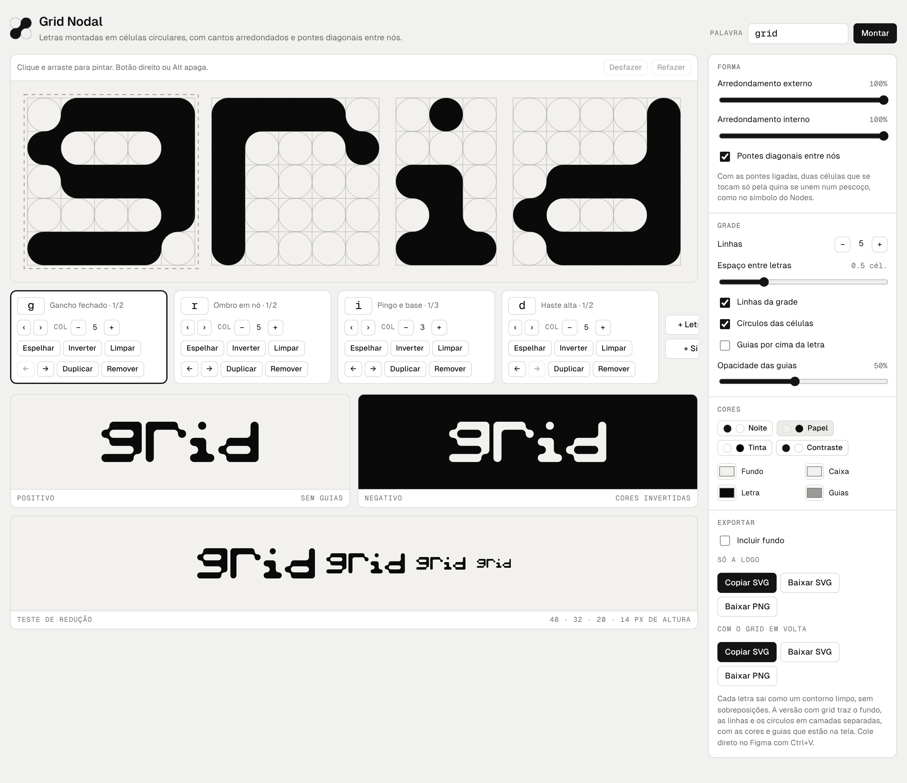
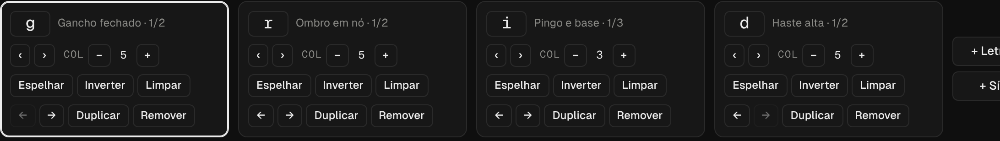
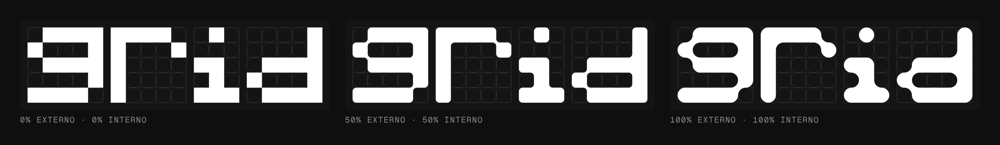
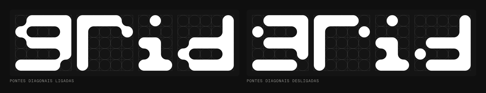
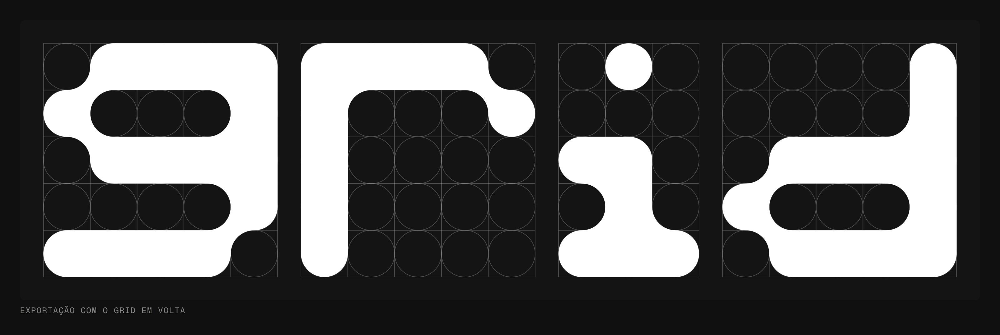
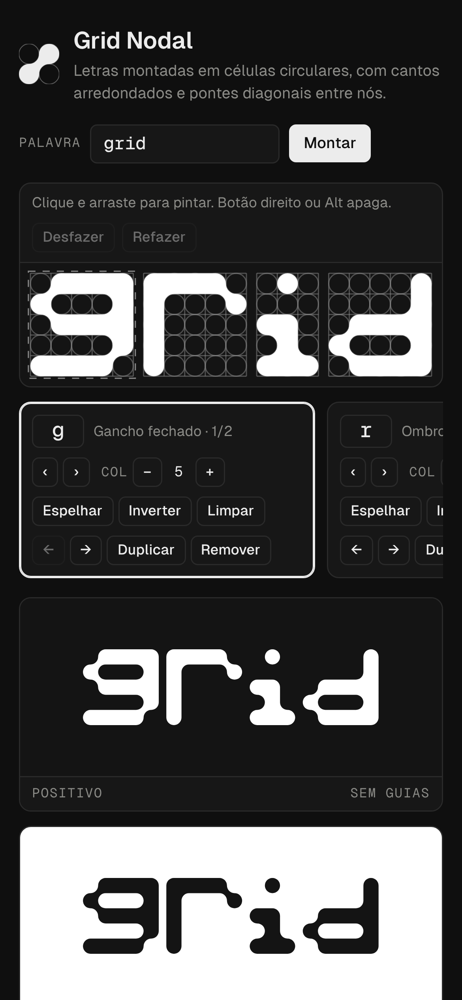

<p align="center">
  <picture>
    <source media="(prefers-color-scheme: dark)" srcset="docs/images/wordmark-branco.svg">
    
  </picture>
</p>

<h1 align="center">Grid Nodal</h1>

<p align="center">
  Editor para desenhar letras e logos em um grid de células circulares.<br>
  Os cantos se arredondam sozinhos e células que se tocam pela quina se ligam como nós de uma rede.
</p>

<p align="center">
  
</p>

---

## Sumário

- [O que é](#o-que-é)
- [Recursos](#recursos)
- [Como usar](#como-usar)
- [Como a forma é calculada](#como-a-forma-é-calculada)
- [Exportação](#exportação)
- [Glifos prontos](#glifos-prontos)
- [Rodando localmente](#rodando-localmente)
- [Estrutura do projeto](#estrutura-do-projeto)

## O que é

O Grid Nodal é uma ferramenta para construir letreiros e logotipos modulares. Cada letra ocupa uma caixa de células (5 × 5 por padrão), e cada célula tem um círculo inscrito que serve de guia. Você pinta as células e o editor gera um contorno vetorial contínuo, com o mesmo tratamento visual de tipografias geométricas feitas sobre grid de círculos.

É uma página HTML única, sem dependências e sem build. Abre no navegador e funciona offline.

## Recursos

- **Desenho direto no grid:** clique e arraste para pintar, botão direito ou Alt para apagar.
- **Arredondamento externo e interno** controlados separadamente, de 0% (pixel reto) a 100% (círculo completo).
- **Pontes diagonais:** células que se tocam só pela quina se unem com um pescoço curvo.
- **Várias letras lado a lado**, cada uma com sua própria largura em colunas.
- **Glifos prontos** com variantes para começar mais rápido.
- **Ações por letra:** espelhar, inverter, limpar, duplicar, reordenar e remover.
- **Linhas da grade ajustáveis** (3 a 12) e espaço entre letras.
- **Prévias** em positivo, negativo e teste de redução (48, 32, 20 e 14 px).
- **Paletas prontas** (Noite, Papel, Tinta, Contraste) e cores livres para fundo, caixa, letra e guias.
- **Exportação** em SVG e PNG, com ou sem o grid em volta.
- **Desfazer e refazer** com Ctrl+Z / Ctrl+Shift+Z.
- **Salvamento automático** no navegador (localStorage).
- **Tema claro e escuro** seguindo o sistema, e layout que funciona no celular.

<p align="center">
  
</p>

## Como usar

1. Digite uma palavra no campo **Palavra** e clique em **Montar**. Letras com glifo pronto já aparecem desenhadas; as outras entram como caixas vazias.
2. Pinte ou apague células direto no canvas.
3. Use **‹ ›** em cada cartão para trocar entre as variantes daquela letra e **− +** para mudar o número de colunas.
4. Ajuste o arredondamento, as pontes diagonais, as guias e as cores no painel lateral.
5. Confira as prévias embaixo do canvas, principalmente o teste de redução.
6. Exporte em **Só a logo** ou **Com o grid em volta**.

<p align="center">
  
</p>

### Atalhos

| Ação | Atalho |
| --- | --- |
| Pintar célula | Clique / arrastar |
| Apagar célula | Botão direito ou Alt + clique |
| Desfazer | Ctrl + Z (Cmd + Z no Mac) |
| Refazer | Ctrl + Shift + Z ou Ctrl + Y |

## Como a forma é calculada

Cada célula é dividida em quatro quadrantes. Para cada quadrante, o editor olha as três células vizinhas que compartilham aquela quina (a do lado, a de cima ou de baixo e a diagonal) e decide a peça:

| Situação do quadrante | Peça gerada |
| --- | --- |
| Célula pintada, vizinhas do lado e de cima/baixo vazias | Canto convexo arredondado (raio externo) |
| Célula pintada com alguma vizinha ortogonal pintada | Quadrante reto |
| Célula pintada, ortogonais vazias e diagonal pintada (pontes ligadas) | Quadrante reto, para formar a ponte |
| Célula vazia com as duas vizinhas ortogonais pintadas | Filete côncavo (raio interno) |

Uma célula isolada vira um círculo perfeito. Um furo isolado vira um círculo vazado. Duas células na diagonal viram dois círculos ligados por um pescoço.

Depois, as peças são unidas em um contorno único por letra: arestas internas que se cancelam são removidas, as restantes são encadeadas em laços fechados e segmentos colineares são mesclados. O resultado é um `path` limpo, sem sobreposições, pronto para edição no Figma ou Illustrator.

### Arredondamento

<p align="center">
  
</p>

### Pontes diagonais

<p align="center">
  
</p>

## Exportação

| Opção | O que sai |
| --- | --- |
| **Só a logo → Copiar SVG** | SVG com um `path` por letra, pronto para colar no Figma com Ctrl+V |
| **Só a logo → Baixar SVG / PNG** | Arquivo `logo-<palavra>.svg` ou `.png` (PNG com ~3000 px de largura) |
| **Com o grid em volta** | Fundo, linhas e círculos da grade em camadas separadas, com as letras por cima. Arquivo `logo-<palavra>-com-grid.svg` ou `.png` |

A opção **Incluir fundo** vale para a exportação só da logo. A versão com grid sempre leva o fundo.

<p align="center">
  
</p>

O SVG desse exemplo está em [`docs/images/exemplo-com-grid.svg`](docs/images/exemplo-com-grid.svg).

## Glifos prontos

Todos usam 5 linhas. Letras sem glifo pronto entram como caixa vazia de 5 colunas.

| Letra | Variantes |
| --- | --- |
| `a` | Contraforma alta, Contraforma baixa |
| `d` | Haste alta, Base reta |
| `e` | Três barras |
| `g` | Gancho fechado, G aberto |
| `i` | Pingo e base, Haste simples, Gancho |
| `l` | Topo e base, Cauda em nó, Haste simples |
| `n` | Arco |
| `o` | Anel |
| `r` | Ombro em nó, Estreito |
| `s` | Barras ligadas |
| `y` | U com cauda, Y em nós, Y aberto |
| `z` | Nós em diagonal, S espelhado, Degraus grossos, Cantos vazados |
| `*` | Símbolo de nó (botão **+ Símbolo**) |

Para adicionar novos glifos, edite o objeto `LIB` no `index.html`. Cada linha é uma string de `0` e `1`:

```js
r: [
  { n: 'Ombro em nó', c: ['11110', '10001', '10000', '10000', '10000'] },
],
```

## Rodando localmente

Não precisa instalar nada. Clone e abra o arquivo:

```bash
git clone https://github.com/joaoferreiral/grid-nodal.git
cd grid-nodal
open index.html        # macOS
xdg-open index.html    # Linux
start index.html       # Windows
```

Se preferir servir por HTTP:

```bash
npx serve .
# ou
python3 -m http.server 8000
```

### GitHub Pages

Em **Settings → Pages**, escolha a branch `main` e a pasta `/ (root)`. O editor fica disponível em `https://joaoferreiral.github.io/grid-nodal/`.

<p align="center">
  
</p>

## Estrutura do projeto

```
grid-nodal/
├── index.html          # editor completo (HTML, CSS e JS em um arquivo)
├── README.md
└── docs/
    └── images/         # capturas e SVGs de exemplo usados neste README
```

## Créditos

Criado por [João Ferreira](https://joaoferreira.site). Inspirado em estudos tipográficos modulares feitos sobre grid de círculos.
